# AstraSynth

**Planetary rover mission planning, end to end:** terrain perception under uncertainty, four route planners on one layered costmap, a behaviour-tree executive that recovers before it gives up, multi-rover deconfliction, Monte Carlo robustness studies, and a 3-D mission control whose rover and terrain are built in Blender by script.

[](backend/tests)
[](backend/requirements.txt)
[](LICENSE)

`FastAPI` · `OpenCV` · `PostgreSQL` · `React` · `TypeScript` · `three.js` · `Blender` · `Docker`

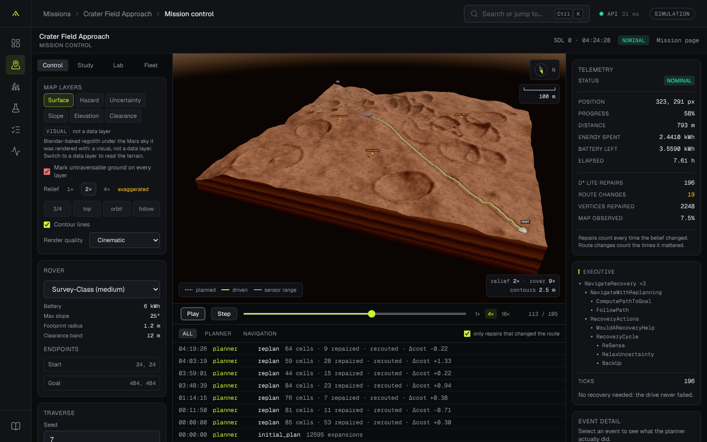

> **Scope.** A planning simulation over public terrain imagery. It does not control hardware, ingest telemetry, or claim flight validation. Rover configurations are illustrative, not manufacturer specifications.

---

## Why this exists

A rover planner that answers "what is the cheapest route across a known map" is the easy part. A real mission asks harder questions: what if the map is wrong, what if the objective competes with the energy budget, what if the ground is worse than the survey said, what does the rover do when it is blocked, and what happens with several rovers sharing the same terrain.

AstraSynth is built around those questions. Each component answers one of them, and every planner shares one cost model, so comparing them measures the search, not four copies of a cost function.

## How it works

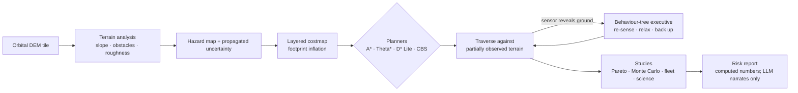

The planners never see the terrain the rover has not observed; the executive decides when to replan and when to recover. The language model, if configured, only turns a report built from computed numbers into prose, and any citation it invents is dropped.

## What is in it

| Area | What it does |
|---|---|
| **Perception** | Slope (Sobel), obstacle contours (adaptive Canny), roughness, and a rule-based terrain classifier. Hazard uncertainty is propagated from named error sources. |
| **Planning** | A\*, Dijkstra, Theta\* (any-angle), D\* Lite (incremental repair), a Pareto sweep over objective weights, and CBS for multi-rover deconfliction. |
| **Costmap** | Nav2-style layers with footprint inflation, combined by max. A lethal feature narrower than a cell survives the reduction. |
| **Execution** | Traverses run against partial observation. A behaviour tree escalates through three recoveries and only reports failure once they cannot help. |
| **Studies** | Route trade-offs, seeded Monte Carlo robustness reported as percentiles, fleet deconfliction, and energy-budgeted science tours. |
| **Service** | Postgres-backed job queue (`SKIP LOCKED`, leases, cancellation), Alembic migrations, structured logs with request IDs, Prometheus metrics, optional API-key auth. |
| **Console** | Overview, Missions, Mission (with runs), Fleet, Studies, Jobs, System, a Ctrl/⌘K palette, and a phone layout. |
| **3-D** | Blender-built rover with steering and wheel tracks, goal beacon, baked regolith and strata, a Mars sky for image-based lighting, and quality presets. |

## Screens

| | |
|---|---|
| 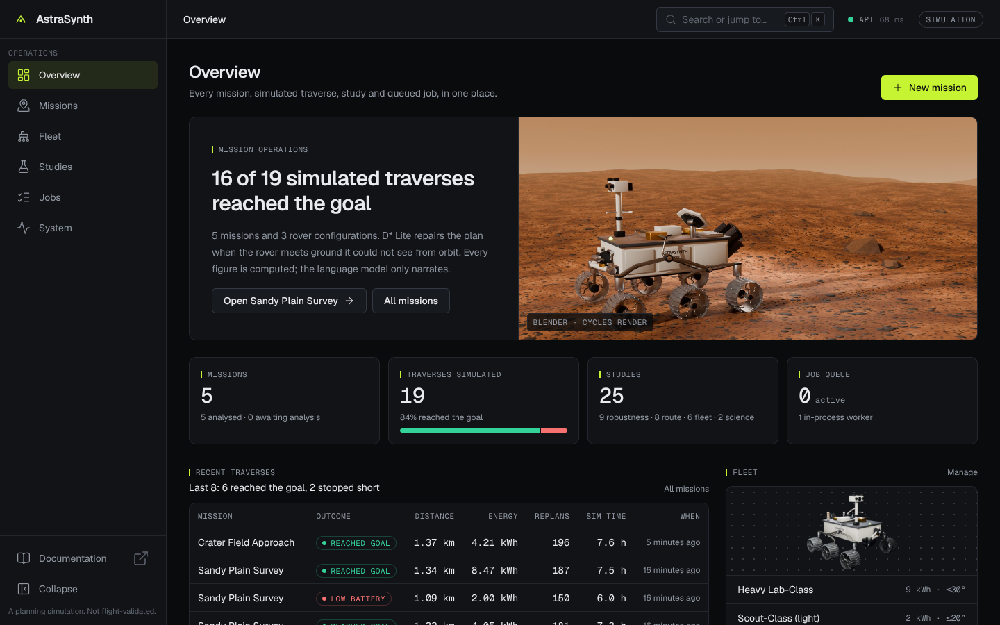 | 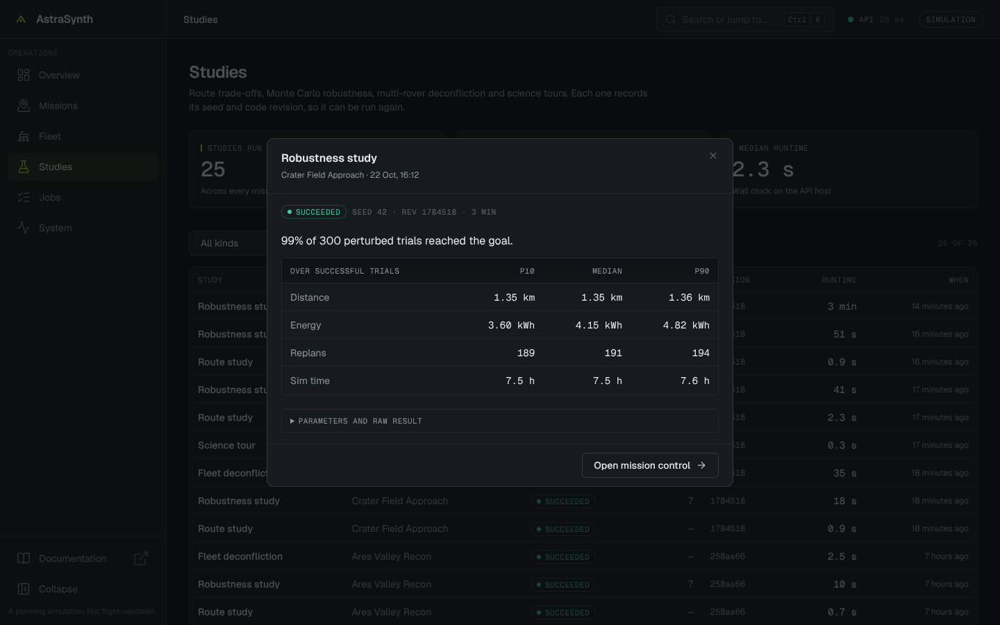 |
| **Overview.** The headline is counted from the traverses on record, not written by hand. | **Study detail.** Percentiles over successful trials, never a bare mean, with the seed and code revision that reproduce it. |
| 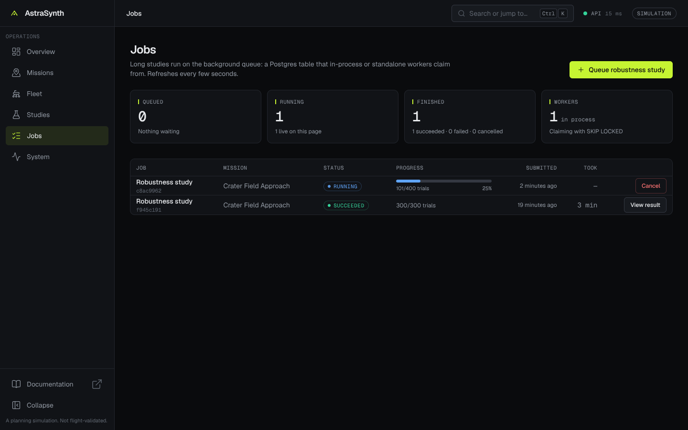 | 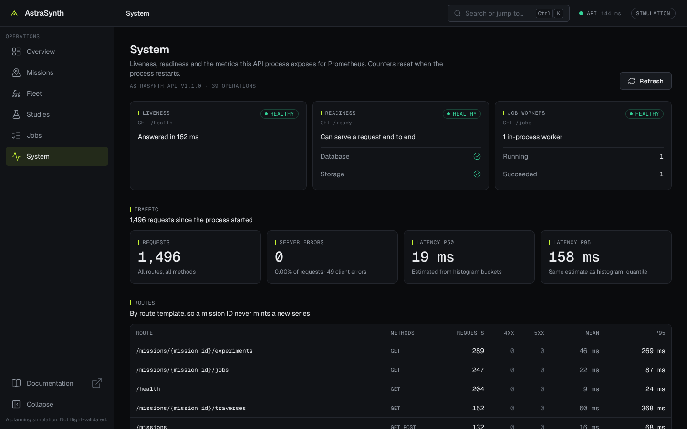 |
| **Jobs.** A study queued from the form, caught by a worker mid-run, with a cancel action. | **System.** Health, readiness and latency per route, parsed from the Prometheus exposition. |
| 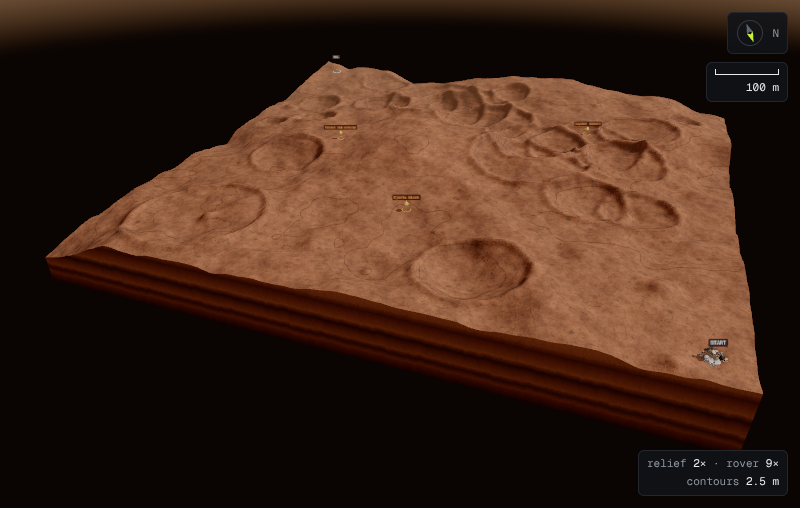 | 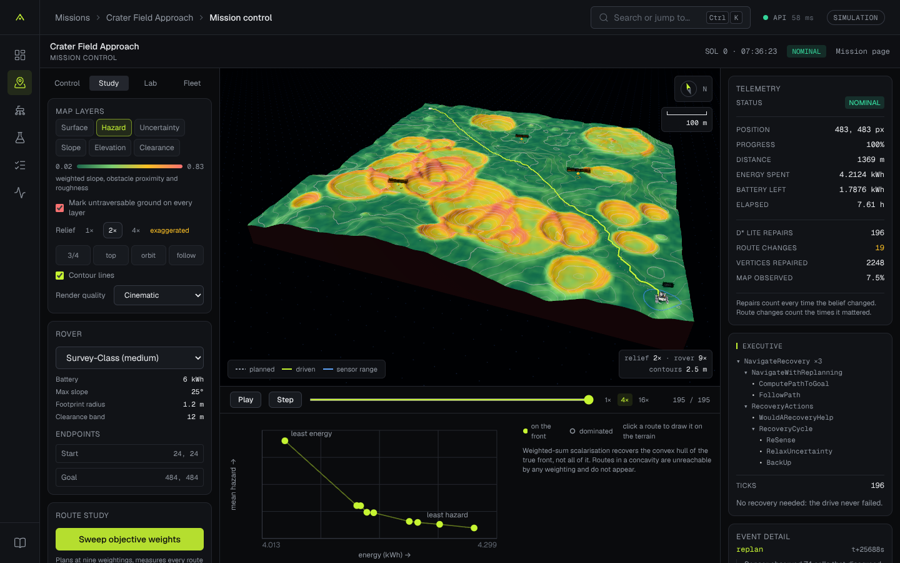 |
| **Planning.** The rover is placed on the map before anything moves, facing the goal. | **Trade-offs.** Nine weightings, the non-dominated front, and the dominated routes shown hollow. |
| 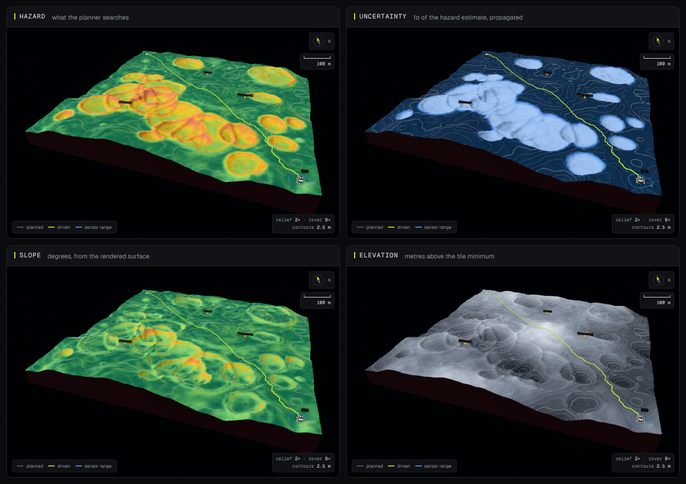 | 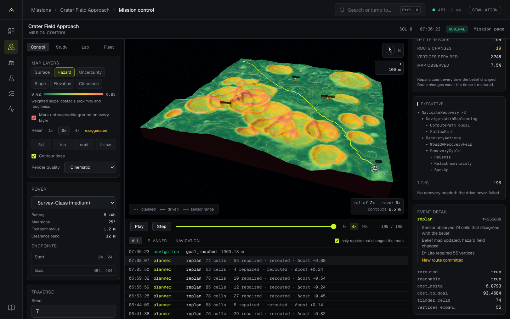 |
| **Data layers.** Each legend is generated from the colour ramp the terrain is drawn with. | **A repair, unpacked.** What the sensor saw, what changed in the belief, and the cost delta. |
| 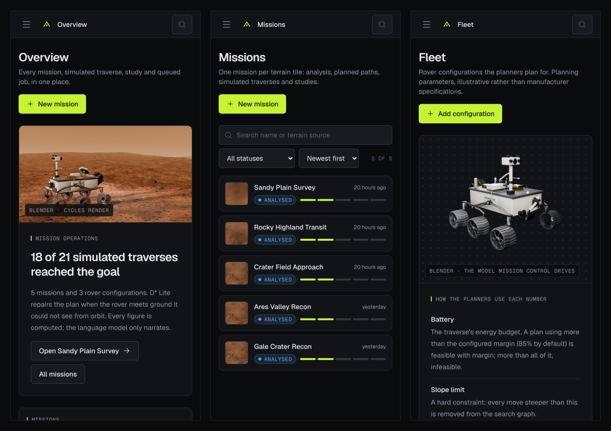 | 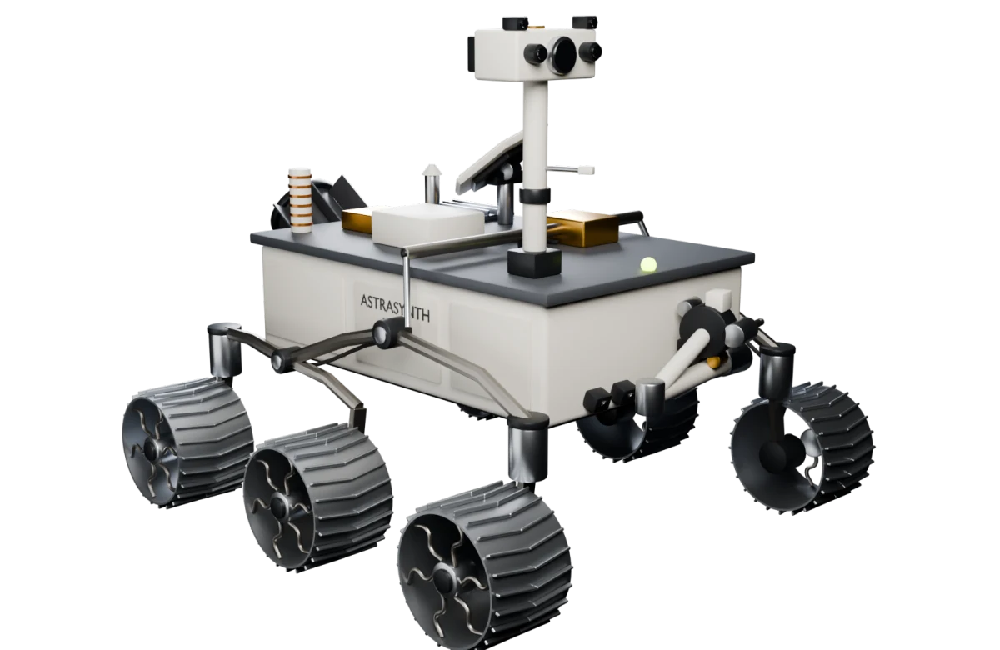 |
| **Phone.** The sidebar becomes a sheet; tables become lists. | **Rover.** Built in Blender by `assets/blender/rover.py`. An illustrative design, not a real vehicle. |

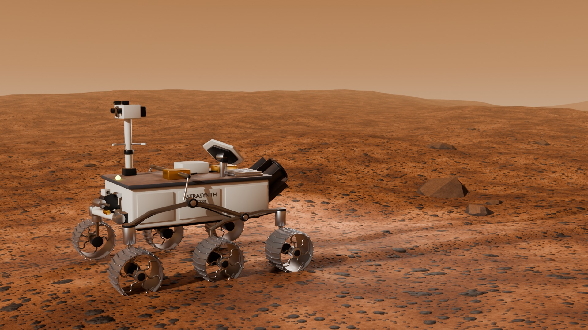

<p align="center"><sub>Cycles render of the rover on regolith, built by <code>assets/blender/build.py</code>. The terrain is a heightfield built for the shot, not a mission tile.</sub></p>

---

## Quick start

```bash
git clone https://github.com/IshaanS0112/AstraSynth.git && cd AstraSynth
python scripts/generate_terrain.py      # synthetic sample tiles, offline
docker compose up --build               # Postgres + API + console
python scripts/seed_demo.py             # optional: fill the console with real runs (~3 min)
```

- Console: http://localhost:5173
- API docs: http://localhost:8000/docs

The language model is optional. Without `ANTHROPIC_API_KEY` set, reports use a deterministic template with the same numbers.

Without Docker, and the full walkthrough with checks after each step, see [`docs/SETUP.md`](docs/SETUP.md).

### Run without a database

```bash
python scripts/run_mission_demo.py      # the full mission pipeline, end to end
python scripts/benchmark_planner.py     # A* against Dijkstra
python scripts/benchmark_v3.py          # Theta*, D* Lite, CBS, Pareto, Monte Carlo
```

### Rebuild the 3-D assets

```bash
python3.11 -m venv .venv-blender && . .venv-blender/bin/activate
pip install -r assets/blender/requirements.txt   # bpy 5.0.1, CPython 3.11 only
python assets/blender/build.py                   # about 15 minutes on 4 cores
```

The built assets are committed, so the app runs without Blender. See [`assets/blender/README.md`](assets/blender/README.md).

---

## Measured results

Every figure comes from a script in this repo.

| Measurement | Result | Source |
|---|---|---|
| A\* against Dijkstra, nodes expanded | 18–37% fewer on 64² to 256² grids, identical optimal costs | `benchmark_planner.py` |
| Warm A\* on a 192² grid | 298 ms → 62 ms, bit-identical results | `docs/planners.md` |
| D\* Lite against replanning from scratch | 97–99% fewer node expansions across a traverse's repairs | `benchmark_v3.py` |
| Robustness | Energy as P10 / median / P90 over successful trials | `monte_carlo.py` |
| Test suite | 416 tests (340 without a database) | `backend/tests` |

Full tables: [`docs/planners.md`](docs/planners.md) and [`docs/uncertainty.md`](docs/uncertainty.md).

---

## Architecture

```
backend/app/
  services/planning/      cost model · costmap · A* · Theta* · D* Lite · CBS · Pareto
  services/simulation/    belief · sensor · traverse execution · behaviour tree · Monte Carlo
  services/mission/       science targets · comms windows · activity timeline
  services/jobs.py        the queue: SKIP LOCKED claim, leases, retries, cancel
  routers/                HTTP API over the engines
frontend/src/
  shell/                  sidebar · topbar · command palette
  pages/                  Overview · Missions · Mission · Fleet · Studies · Jobs · System
  three/                  3-D renderer: terrain, rover, surface materials, post-processing
assets/blender/           scripts that build every 3-D asset
scripts/                  demos, benchmarks, terrain tools, seed_demo.py
docs/                     architecture, planners, uncertainty, frontend, operations, gallery
```

[`docs/architecture.md`](docs/architecture.md) covers the design decisions and the defects found while building this. [`docs/frontend.md`](docs/frontend.md) covers the console and renderer. [`docs/operations.md`](docs/operations.md) covers running the service.

---

## Tests and checks

```bash
cd backend && python -m pytest                 # 416 tests, with PostgreSQL running
ruff check . && ruff format --check .
cd frontend && npm run typecheck && npm run build
```

Property-based tests (`backend/tests/test_planner_properties.py`) check invariants across generated terrain, such as A\* and Dijkstra agreeing on the optimum, and D\* Lite matching a fresh search after a map change.

---

## Terrain data

The repo ships a generator, not a dataset. `scripts/generate_terrain.py` makes synthetic tiles from a seed. For real data, `scripts/prepare_usgs_terrain.py` crops a tile from the USGS global Mars DEM:

> **Mars MGS MOLA – MEX HRSC Blended DEM Global 200m v2**, USGS Astrogeology Science Center, 2018.
> Fergason, R. L., Hare, T. M., & Laura, J. (2018). *HRSC and MOLA Blended Digital Elevation Model at 200m v2.* Astrogeology PDS Annex, U.S. Geological Survey.

---

## Roadmap

- [ ] Orientation-aware footprint for a rectangular chassis
- [ ] Communications coverage as a map layer
- [ ] Active exploration: moving to reduce uncertainty
- [ ] A learned terrain classifier, compared head-to-head with the rule-based one
- [ ] Summary endpoints, so cross-mission console pages stop fanning out per mission

---

## Licence

MIT. See [LICENSE](LICENSE). Terrain data from USGS Astrogeology is public domain; the citation above is required by the dataset's access constraints.
