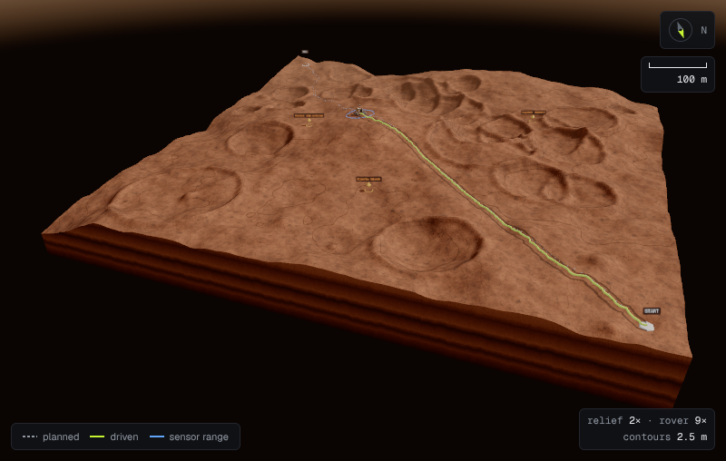

# Frontend

Three surfaces over the same API.

**The console** (`shell/`, `pages/Overview`, `Missions`, `Fleet`, `Studies`,
`Jobs`, `System`) is where an operator starts: what has run, what is queued, what
the fleet is, whether the service is healthy. It is described first, below.

**The mission pages** (`pages/MissionDetail`, `NewMission`) are the V1 flow:
upload a tile, analyse it, click a start and a goal, plan, assess, generate a
report. The mission page's second tab lists every traverse, study and job run
against that mission.

**Mission control** (`pages/MissionControl`) is the V3 view, and it inverts the
layout. In the mission pages the numbers are the page and the map is an
illustration. In mission control the terrain *is* the application and everything
else is a drill-down from it, because the questions an operator actually asks are
geometric ("where is it, where is it going, what is it about to drive into") and a
table makes them reconstruct the geometry in their head.

---

## The console

**The shell.** A 240 px sidebar with six destinations, a 56 px topbar and a main
area that scrolls on its own. Below `lg` the sidebar becomes a 64 px icon rail,
and on a phone a sheet behind a menu button. Mission control always gets the rail,
because the terrain wants the width. The operator can collapse it anywhere else;
the choice is remembered.

**The topbar** carries breadcrumbs (with the mission's name, fetched once and
cached), the command palette, a liveness probe and a `SIMULATION` badge. The probe
calls `/health` every 15 seconds and prints the round trip. It is labelled API, not
"system", because liveness says the process answers and nothing more; readiness
is on the System page.

**⌘K / Ctrl K** opens a palette over pages, actions (new mission, add a rover
configuration, queue a robustness study) and every mission, each with a jump
straight into its mission control. Every token typed has to match, so "gale
control" finds one row.

| Page | Reads | What it is for |
|---|---|---|
| Overview | missions, rovers, queue, every mission's traverses and studies | The claim first ("15 of 18 simulated traverses reached the goal"), then four KPIs, recent traverses, fleet, system and mission cards |
| Missions | `/missions` | Search, status filter and sort, kept in the URL so a filtered list can be linked |
| Mission | the pipeline stages; traverses, studies and jobs | Pipeline tab, and a Runs tab with everything run against the mission |
| Fleet | `/rover-configs` | One card per configuration with its flat-ground range, what each parameter does to the planner, and a validated form to add one |
| Studies | every mission's experiments | Filter by kind and outcome; a study opens with its result summarised (P10/median/P90, the Pareto front, per-rover costs, targets visited) and its raw parameters, seed and code revision |
| Jobs | `/jobs`, every mission's jobs | Queue depth and workers, live progress, cancel, and a form that queues a robustness study on the background worker |
| System | `/health`, `/ready`, `/jobs`, `/metrics`, `/openapi.json` | Liveness, readiness, workers, and per-route traffic, error and latency figures parsed from the Prometheus exposition |

**Latency figures are the histogram's own estimate.** The System page interpolates
inside buckets the way PromQL's `histogram_quantile` does, and a quantile that
falls past the last finite bucket prints as "> 30 s" rather than as 30 s, which
would read as smaller than a mean it exceeds.

**Data views have three states besides the data.** A skeleton the shape of what
is coming, an empty state that says what will appear and offers the action that
fills it, and an error that says what happened in words, offers a retry and keeps
the status code behind a disclosure. Polling refreshes in place; it never blanks
what is on screen. Actions that finish out of sight (a job cancelled, a rover
saved) confirm with a toast.

**The API is per mission, so cross-mission pages fan out**, four requests at a
time, over the missions the list endpoint returns (the 50 most recent, by
default), and skip missions that have never been analysed. That is fine at
portfolio scale and is the first thing to replace with a summary endpoint if the
mission count grows.

**Mission thumbnails are shaded relief of the actual DEM**, computed in the
browser: Lambert lighting on the tile's own gradients from the north-west, with
vertical exaggeration scaled to the tile's relief, tinted with tones sampled from
the Blender-baked regolith. A grey heightmap reads as noise at thumbnail size;
the same data shaded reads as ground.

---

---

## The renderer is not a React component

`three/TerrainScene.ts` is a plain class. It owns a canvas, a scene graph and an
animation loop, and it knows nothing about React, the API, or mission state. Its
interface is a handful of coarse setters — terrain, layer, routes, markers, rover
pose, contours, exaggeration, camera view — and each rebuilds only what it owns.

`mission-control/TerrainView3D.tsx` is the only file that bridges the two, and it
maps each prop to exactly one setter behind an effect keyed on that prop alone.
That is what stops a telemetry tick from rebuilding a terrain mesh, and a layer
change from rebuilding the routes.

The split matters more than it looks. A scene graph is mutable state with a
lifetime; a React tree is a pure function re-run on every change. Expressing the
first as the second means either rebuilding WebGL resources far more often than
necessary, or threading refs through everything until the component is a class
with extra steps.

**One frame of reference, defined once.** `cellToWorld(row, col)` is the single
place a grid cell becomes a position, and every route, marker, ring and pick goes
through it. Routes arrive from the API in *image pixels*; `pixelToCell` converts
at the boundary, so nothing downstream needs to know what resolution the viewer
happens to be showing. Heights are bilinear between vertices, so anything draped
on the terrain sits on it rather than floating over a valley or sinking into a rim.

**WebGL resources are not garbage collected.** Scrubbing a traverse rebuilds the
route group on every frame, so `clearGroup` disposes geometries, materials and
label textures explicitly. Without it, the leak is per frame, not per mount.

---

## What is drawn

| | |
|---|---|
| **Terrain block** | One mesh at twice the grid's resolution, heights between cells interpolated bicubically so rims stay round; side walls down to a base so it reads as ground rather than a sheet; soft shadows from a single sun on a 4096 px map |
| **Contours** | Marching squares over the elevation grid at a round interval (0.5, 1, 2, 2.5, 5 … m), every fifth line major |
| **Routes** | The driven route as a lit tube in the accent, the original plan as a dotted trail under it, study and fleet routes as thinner tubes |
| **Markers** | A start pad, a goal pole with a pulsing ring, science targets as gems with a halo; labels are sprites in the console's mono face and always face the camera |
| **Rover** | The Blender rover, or a procedural one if the file does not load (below) |
| **Goal beacon** | A Blender survey tripod with a pulsing lamp, at the rover's display scale |
| **Wheel tracks** | In the Surface view only, along the driven path, at the rover's gauge and wheel width |
| **Rings** | The sensor range, draped over the ground at true scale |
| **HUD** | A compass, a scale bar that follows the zoom, and a chip listing every departure from true scale |

### The rover

The rover is built in Blender by script (`assets/blender/rover.py`, see
[its README](../assets/blender/README.md)) and loaded from `rover.glb`: six wheels
on a rocker-bogie, a remote-sensing mast with a stereo head, a hexagonal high-gain
antenna, a finned RTG and a stowed arm, 77,208 triangles. The layout follows the
six-wheeled rocker-bogie family; the proportions are illustrative, not any real
vehicle's drawings.

The file carries named pivots, and `three/RoverModel.ts` drives them:

- **Wheels** turn by the distance actually covered, so playback speed and wheel
  speed agree.
- **Corner wheels steer.** Curvature is the chassis's heading change per metre
  rolled, and each corner takes its Ackermann angle,
  `atan(ahead · k / (1 − left · k))`: the inner wheels turn further than the outer,
  and the rear pair steers against the front. The middle pair is fixed, as on the
  real layout.
- **The mast** pans slowly between drives, and **the status light** pulses: the
  one accent on the model.

Each pose is pitched and rolled to the terrain normal under it, and the model
eases towards it. With `prefers-reduced-motion` set, poses snap and nothing idles.

If `rover.glb` fails to load, the same class builds the rover from primitives
instead, with the same pivots and the same animation, so a missing asset costs
looks and nothing else.

While planning, the rover is parked at the start facing the goal: what is being
planned for is on the map before it moves, and the rover panel beside it lists the
numbers the planner uses for it — battery, slope limit, footprint and clearance band.

---

## Layers

Surface first, then the data: elevation, hazard, propagated uncertainty, slope
and — when a rover is selected — its clearance band, as vertex colours on one
mesh. Switching layers rewrites a colour attribute and swaps a material; it does
not rebuild geometry.

### The Surface view is a picture, and says so

The Surface layer shows the ground as it would look, and the layer list and its
legend both label it a visual, not a data layer. It is built from the Blender
pipeline's output:

- **Regolith** baked from a procedural shader graph into albedo, normal and
  roughness maps that tile without seams. The albedo is sampled at two scales and
  blended in the shader, so the tile never reads as a grid. A macro tint from the
  grid itself darkens steep ground towards bare rock and lifts high ground.
- **Strata** on the sides of the terrain block, so it reads as a cut through
  layered sediment rather than a painted box.
- **A Mars sky**: a gradient dome for what the camera sees, and an HDR
  environment map, prefiltered with PMREM, for what the rover's metal and paint
  reflect. The sun comes from the sky's sidecar file, so shadows fall the way the
  sky says they should.
- **AgX tone mapping and a dust haze.** The data layers use neutral tone mapping;
  the Surface view uses AgX, the same view transform the Blender renders use, so
  the live view and the renders agree.
- **Wheel tracks** along the driven path, at the rover's gauge and wheel width
  with grouser marks, darker than the ground around them the way disturbed
  regolith is. They are drawn only here: on a data layer they would be noise.

**Lethal ground is still marked on the Surface view.** A picture of a crater rim
that hides the fact the rover cannot cross it would be worse than no picture.

**Image-based lighting is set per material, not on the scene.** The data layers
must render at their legend colours, and a scene-wide Mars environment would tint
every one of them orange.

**Untraversable ground is marked on every layer, not just the hazard one.** An
operator reading the slope map still needs to see where the rover cannot go.
Making them infer it from a different tab is how a route gets approved across a
crater rim.

**The clearance layer is the planner's own costmap.** It is fetched per rover,
because the footprint decides it: the inflation band around every obstacle, at
the resolution the planner searched. On terrain with nothing over the lethal
threshold the band is empty, and the legend says so in words rather than drawing
a uniform colour that looks like a rendering fault. All three bundled sample tiles
are like that at the default threshold — see [planners.md](planners.md#the-layered-costmap).

### Colour is the measurement

A hazard map is read by its colour, so the colour pipeline is part of the
instrument.

- **Ramps are built from status tokens** — hazard runs success → warning → danger,
  the same three colours the rest of the console uses for good, caution and bad —
  and each legend is generated from the same ramp the terrain is drawn with, never
  retyped.
- **Vertex colours are converted from sRGB to linear** before they reach the GPU.
  three.js reads vertex colours as linear light; written as sRGB they come out
  paler than the legend beside them, and a 0.4 hazard reads as a 0.2.
- **Tone mapping is neutral, not filmic.** ACES shifts hue and saturation, which is
  what makes a film look like film and a data layer lie. Khronos PBR Neutral leaves
  everything below its shoulder alone and only rolls off sunlit highlights.
- **The lights are balanced so flat ground renders at its legend colour** — the sun
  contributes about 0.72 of the albedo and the sky about 0.29 — so shading carries
  the relief and never the data.

The tokens come from CSS variables at runtime (`three/palette.ts`), so the
stylesheet is the single source of truth for the page and the scene alike.

### Every departure from true scale is printed

Three things on screen are not to scale, and the HUD chip says which, by how much:

- **Relief** opens at 2×. At true scale 40 m of relief across a kilometre is nearly
  flat paint, and at 2× the crater rims read as rims. The chip and the control both
  say "exaggerated" until it is set back to 1×, and the colours come from the data
  at any setting — only the apparent steepness changes.
- **The rover** is drawn at a fixed size on screen relative to the grid — about
  nine times life size on the bundled 1 km tiles at the 128-cell grid mission
  control fetches — because a 3 m vehicle on a 1 km tile is under a pixel. The
  factor is computed from the grid, not typed in, and the wheel tracks are drawn
  at the same factor so they stay under the wheels.
- **Contours** print their interval.

The sensor ring is the opposite case: drawn at true scale, and only when it
reaches past the enlarged model. A true-scale ring hidden under a 9× rover would
claim a precision the view does not have, which is why the clearance radius is
shown as numbers in the rover panel and as the clearance layer, not as a ring.

---

## Post-processing and quality

| Preset | Pixel ratio | Passes |
|---|---|---|
| Performance | 1 | Straight to the canvas, with the context's own antialiasing |
| Balanced | 1.5 | A multisampled half-float target, bloom on emissive parts, output |
| Cinematic | 2 | Adds ground-truth ambient occlusion (GTAO), radius scaled to the terrain cell |

Bloom's threshold sits above sunlit white paint, so only what emits light glows:
the status light, the beacon's lamp. Ambient occlusion darkens creases, never flat
ground, which is why the data layers keep their legend colours with it on.

**Auto** starts Balanced, skips 45 frames while shaders compile, then judges 90
frames once: under 18 ms a frame it steps up to Cinematic, over 42 ms down to
Performance. It does not keep hunting. The operator can pick a preset instead;
the choice is remembered, and `?quality=cinematic` in the URL forces one for a
screenshot.

---

## Camera

Four presets — three-quarter, top, orbit, follow.

**Three-quarter frames itself.** It finds the nearest camera distance at which
the whole terrain block fits the canvas's current aspect (fitting only gets
easier with distance, so it bisects), then slides the aim point along the ground
to wherever the block can be drawn largest, because perspective draws the near
half larger than the far half and aiming at the middle wastes the top of the
frame. The same code frames a phone and a wide monitor. It stands on the rover's
side of the map, a little off its diagonal, so the rover is in the foreground and
the route runs away from the viewer. Until the operator drags or zooms, it refits
on every resize.

**Follow** sits behind the rover and to one side, looking where it is headed, and
carries the camera with it without taking the orbit away from the operator.

**Top** keeps north up the screen; it is where you check whether a detour actually
went around the thing it was avoiding.

---

## Playback

The traverse comes back as a complete run: the initial plan, the executed path,
the behaviour tree's record, and a timestamped event log. Playback scrubs an index
through that, so it is a replay rather than a live stream — the simulation already
finished on the server.

The clock is a fixed 120 ms interval, **not** `requestAnimationFrame`. A
simulation clock tied to the renderer's frame rate plays the same run at
different speeds on different machines.

The event log distinguishes a **repair** from a **reroute**. With a noisy sensor
almost every step changes the belief slightly and triggers a D* Lite repair, so a
raw repair count is a number about the sensor, not about the mission. What an
operator needs is the handful of times the route actually changed, which is the
default filter.

The **executive panel** draws the behaviour tree that drove the run, with each
recovery that fired and why — or "no recovery needed" when the drive never
failed, which is the common case and worth seeing stated.

---

## Charts

Both are single-series by design.

The **Pareto plot** shows routes, not competing categories, so it uses emphasis —
one hue for the front, muted outline for the dominated — rather than a categorical
palette, and fill-versus-outline carries the distinction without relying on colour
at all. Only the corners of the front are direct-labelled; a label on every point
goes unread. Clicking a route draws it on the terrain.

The **robustness panel** leads with a number, because "will this mission finish"
has one answer and a bar chart of a single value is not a chart. Below it, a
percentile strip rather than a mean, and a failure breakdown where each mode ships
an icon and a label so the status colour is never carrying the meaning alone.

Where identity genuinely matters — one colour per rover in a deconflicted fleet —
the routes take the chart series tokens in order, `chart-2` to `chart-5`, and the
accent is kept for the route the rover actually drove.

---

## Design system

Graphite: a dark engineering-console theme, defined once as CSS variables holding
RGB triplets (`index.css`), consumed by Tailwind through `rgb(var(--token) /
<alpha-value>)` so opacity modifiers work, and by the 3-D scene through
`palette.ts`. Tailwind's default palette is replaced, not extended, so a stray
`bg-purple-500` does not compile into anything.

One accent, a lime, kept to roughly 5% of the screen: the driven route, the primary
action, the active state, the compass needle and the tick beside a section label.
Active toggles are tinted rather than filled so they do not compete with the one
button that matters. Helper text is `muted`, not `subtle` — anything a person must
read meets contrast.

**From `lg` up** the page is three panes, terrain in the middle. **On a phone** it is
one column with the terrain first, the HUD chips in a row so they do not cover a
third of the map, and every control 40 px tall.

---

## Bundle

three.js is most of the JavaScript, and most visits never open the 3-D view, so
`MissionControl` is behind `React.lazy` and three.js is split into its own chunk.

| What | Raw | Gzipped | When |
|---|---|---|---|
| Entry (React, router, every console page) | 293 kB | 89 kB | First load |
| Mission control | 197 kB | 57 kB | Opening mission control |
| three.js | 547 kB | 140 kB | Same, cached separately because it changes least |
| Blender assets mission control loads | 5.2 MB | 2.7 MB | Same; the rover is 2.9 MB raw and 0.67 MB gzipped, the textures are already JPEG |

The nginx config gzips the scripts, the 3-D assets and the API's JSON (a terrain
grid is a few hundred kilobytes of floats), caches fingerprinted scripts for a
year and the Blender outputs for a day.

---

## What CI checks, and what it does not

CI typechecks and builds. That proves the code compiles; it does not prove the
terrain mesh renders, that clicking the terrain places a target where the operator
aimed, or that a 30-second study returns before the page gives up.

`scripts/check_mission_control.mjs` drives the real thing in a real browser —
loads a mission, runs a traverse, sweeps the weights, runs a robustness study,
places science targets by clicking the terrain, deconflicts a fleet — and fails on
any console error, page error or failed request. It is **not** in CI, because a CI
job that downloads Chromium to screenshot a page is a slow way to learn the build
works. It is in the repo so the check is repeatable rather than something that
happened once on a laptop. Its usage is in its header comment.
