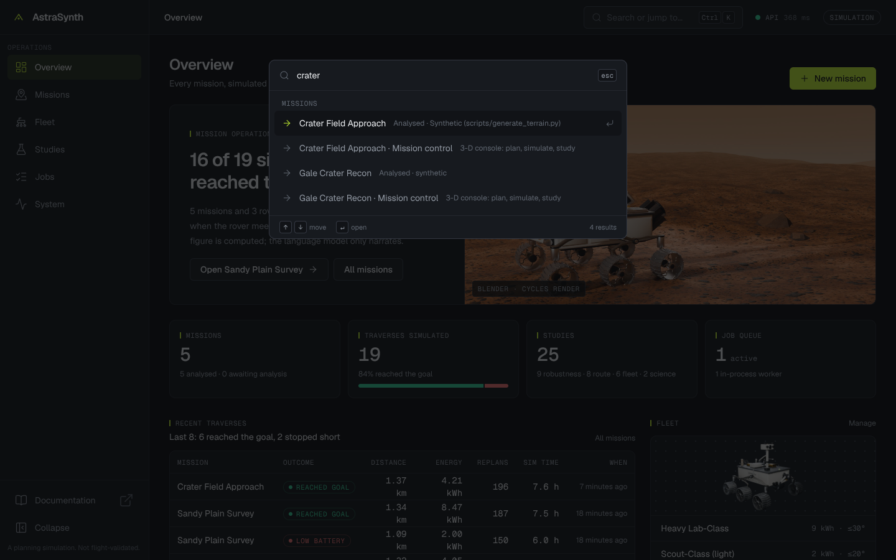
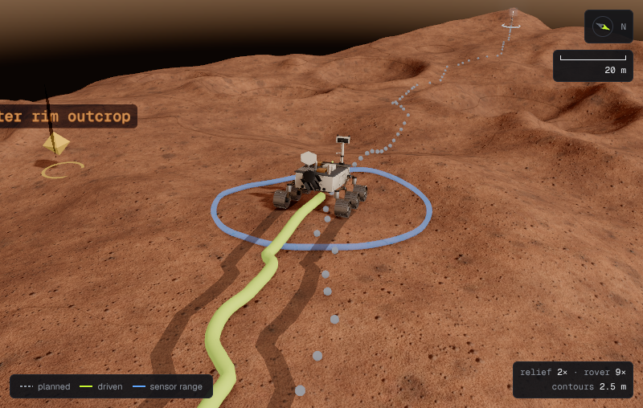
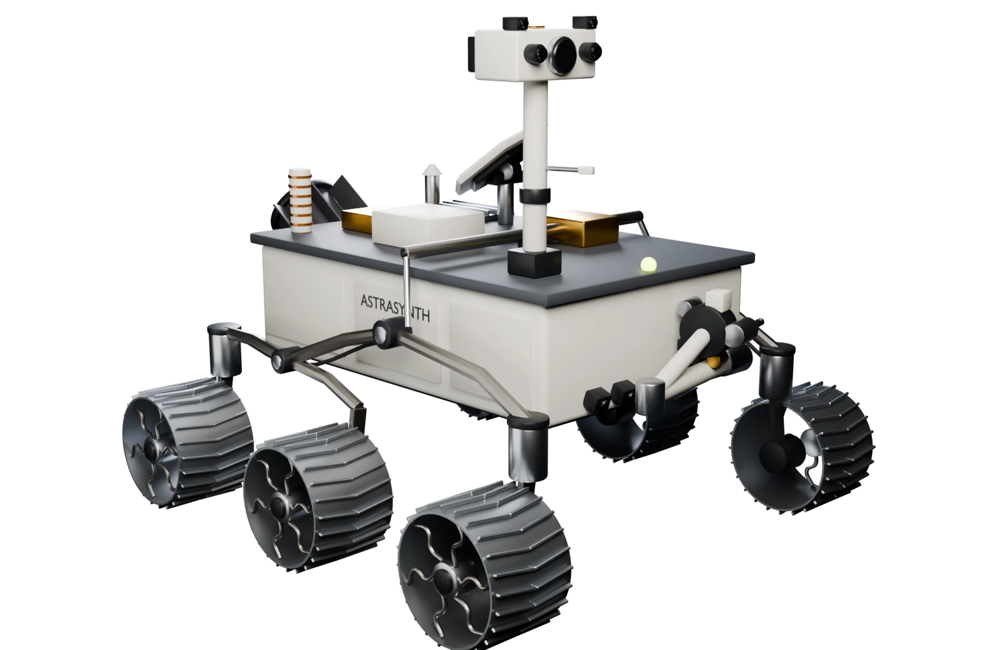
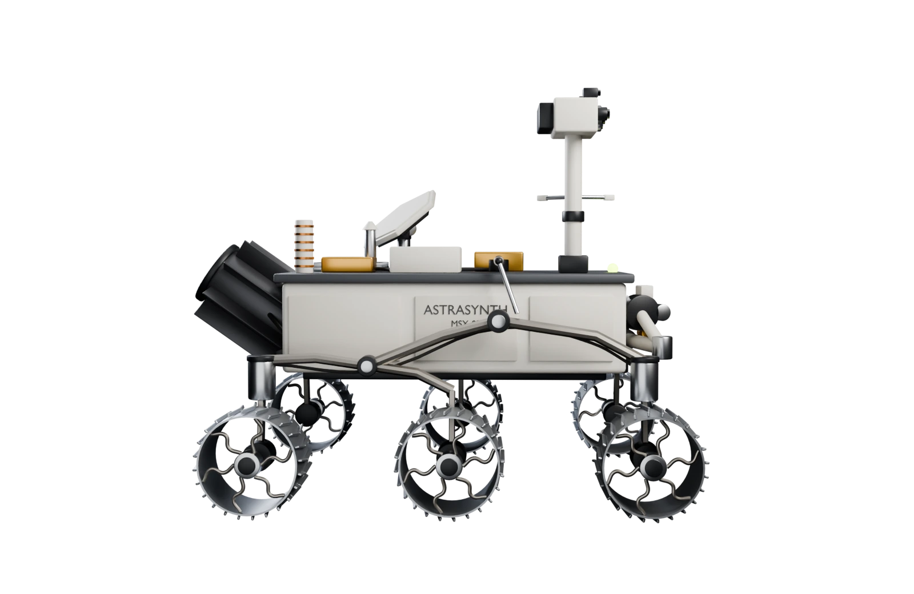
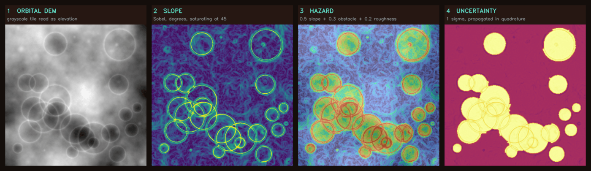
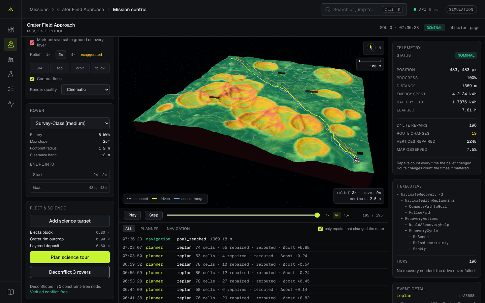
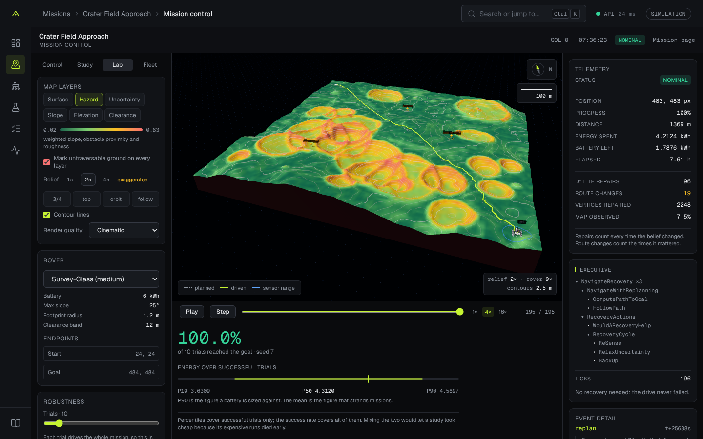
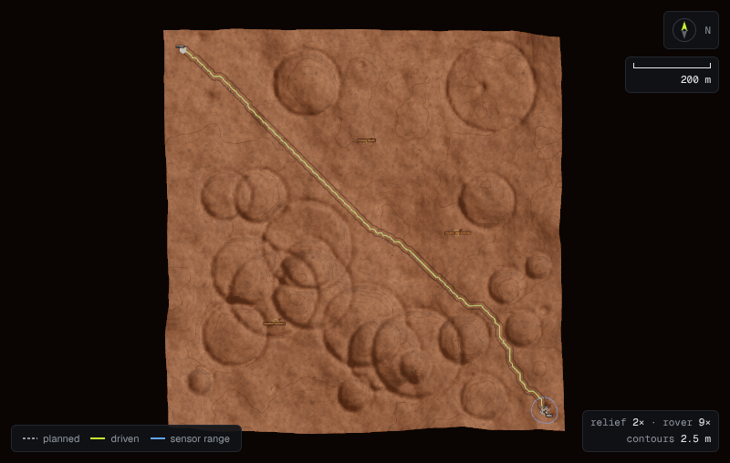

# Gallery

Screenshots from real runs against generated terrain, captured in a real browser
against a running stack. Nothing here is a mock-up, and every number in the
captions was read off the screen it describes.

The mission-control run: `synthetic_crater_field_512.png` (the "Crater Field
Approach" mission that `scripts/seed_demo.py` creates), the Survey-Class rover
(6 kWh, 25° slope limit, 1.2 m footprint, 12 m clearance band), seed 7, from pixel
(24, 24) to (484, 484) — the defaults mission control opens with.

---

## The console


Where an operator starts. The headline is counted from every traverse on record
(16 of 19 reached the goal when this was taken), then four figures with what each
is measured against: missions and how many are analysed, traverses with their
success rate as a bar, studies by kind, and the job queue with its workers. Below,
the latest traverses across every mission, the fleet, and the service's health.
The banner is a Blender render, and says so in its corner.


A study opens with its result summarised for its kind. This one is a 300-trial
robustness study that ran on the background queue: 99% of perturbed trials
reached the goal, and energy over the successful ones ran 3.60, 4.15 and 4.82 kWh
at P10, median and P90. The seed (42) and code revision (`1784518`) are on the
first line, because a study you cannot re-run is an anecdote.


A 400-trial study queued from the form on this page, caught by a worker and
101 trials in. The page polls every three seconds; the progress line is the
worker's own, written as it goes. The finished job above it links to its result.


Liveness, readiness and workers, then traffic per route template, parsed from
the Prometheus exposition the API serves. Latency is the histogram's own
estimate, interpolated inside buckets the way `histogram_quantile` does; a
quantile past the last finite bucket prints as "> 30 s" rather than 30 s.



⌘K or Ctrl K, from anywhere. Every typed token has to match, so "crater" finds
both crater missions and a jump straight into each one's mission control.


The same pages at 390 px: the sidebar becomes a sheet, tables become lists, and
every control stays 40 px tall. Mission thumbnails are shaded relief of each
mission's own DEM, computed in the browser.

---

## Mission control


The terrain is the application. It is shown here in the Surface view:
Blender-baked regolith under the Mars sky it was rendered with, which the layer
list and the legend both label a visual rather than a data layer. The lime line
is the route the rover has *driven*; the dotted line under it is the route it
originally planned from the orbital map. The shell is reduced to an icon rail so
the terrain has the width.

The right rail separates two numbers that are easy to conflate. **D\* Lite repairs**
counts every time the belief map changed enough to re-run the incremental
search — with a noisy sensor that is most steps. **Route changes** counts the times
that repair produced a different next move. 196 against 19 over the whole run:
the rover was constantly re-checking and rarely surprised, which is what you want
and is invisible if you only report one of them.

Under it, the **executive**: the behaviour tree that drove the run, after Nav2's
navigate-with-recovery. This drive never failed, so no recovery fired, and the
panel says that in words.

The event log is filtered to repairs that changed the route by default, and each
row carries what the repair cost: cells that disagreed, vertices repaired, and the
change in cost-to-goal.

---

## Before the drive


While planning, the rover is on the map — parked at the start, facing the goal —
and the camera frames itself from the rover's side, so what is being planned for
sits in the foreground and the route will run away from the viewer. The view fits
the whole block to whatever shape the canvas is, phone or monitor. The block's
sides carry baked sediment strata, so it reads as a cut through ground rather than
a painted box.

The chip in the corner lists every departure from true scale: relief is
exaggerated 2×, the rover is drawn 9× life size so it is visible at all on a
kilometre-wide tile, and the contour interval is 2.5 m.

---

## The rover



The follow camera, mid-drive. The rover is built in Blender by script — six
wheels with grousers on a rocker-bogie, a mast with a stereo head, a hexagonal
high-gain antenna, an RTG and a stowed arm — and posed to the ground under it.
Its wheels turn by the distance covered, and its corner wheels steer to the
Ackermann angle for the curvature it is actually driving.

Behind it, its wheel tracks: two darker strips with grouser marks along the
driven path, at the rover's gauge and wheel width and at the same 9× as the
model, so they stay under the wheels. They are drawn in the Surface view only; on
a data layer they would be noise.

The blue ring is the sensor range, drawn at true scale and draped over the ground.
It is drawn only because it reaches past the enlarged model; a true-scale ring
hidden under a 9× rover would claim a precision the view does not have. Ahead, the
dotted trail is the original plan, which the driven route has already left.

---

## Built in Blender


<p align="center">
  
  
</p>

Every 3-D asset is built by Python scripts running Blender as a module, and so
are these stills: `python assets/blender/build.py` rebuilds all of them. The hero
is Cycles at 160 samples, denoised, with AgX colour management; its ground is a
heightfield built for the shot (a mission tile at 2 m per pixel has nothing to say
about the ground under a 3 m rover), with rocks scattered to a power-law size
spread and the wheel tracks the rover left on its way in. The rover is not any
real vehicle. [`assets/blender/README.md`](../assets/blender/README.md) has the
pipeline.

---

## The analysis chain



Four stages over one tile, all four written to `storage/<mission>/` by
`POST /analyze-terrain`. Slope is Sobel over the elevation model; hazard is the
weighted blend; uncertainty is 1σ propagated in quadrature from DEM
quantisation, Canny edge localisation and window sampling.

The uncertainty panel is worth a second look, because it is nearly bimodal —
bright at and inside crater rims, dark on the plains. That is not a rendering
artefact: the obstacle-proximity term's σ goes as `1/(1+d)²` and dominates the
quadrature sum near an obstacle while collapsing to almost nothing away from
one. The field really is concentrated. The colour scale saturates at the 99th
percentile of the field rather than a fixed constant, and the value used is
recorded in `analysis_metadata.uncertainty_map_scale` — a colour map whose scale
is not written down is not a measurement.

---

## The same ground, four ways


Same terrain, same camera, same route, now finished. Switching layers rewrites a
colour attribute and swaps a material; it does not rebuild the mesh. Each ramp is
built from the console's status colours and converted to linear light before it
reaches the GPU, so the terrain renders in the colours its legend shows rather
than a paler version of them. The data layers use neutral tone mapping and no Mars
sky in their lighting, so nothing tints them.

Untraversable ground is marked on **every** layer, the Surface view included — an
operator reading the slope map still needs to see where the rover cannot go, and
making them infer it from another tab is how a route gets approved across a
crater rim. On this tile nothing reaches the lethal threshold, so nothing is
marked.

Relief opens at 2× and says so, beside the control and in the corner of the view:
at true scale 40 m of relief across a 1 km tile is nearly flat. 1× is one click
away, and the colours come from the data at any setting.

---

## A repair, unpacked


Clicking a repair in the event log reconstructs what happened, in order: the
sensor observed 74 cells that disagreed with the belief, the belief map was
updated, D\* Lite repaired 55 vertices, and a new route was committed. Underneath,
the raw record: `rerouted`, `cost_delta`, `cost_to_goal`, `trigger_cells`,
`vertices_expanded`.

This one made the route *more* expensive: `cost_delta` is +6.88. A repair is not
an improvement; it is the cheapest route given what the rover now knows, and here
the rover had just learned the ground ahead was worse than the orbital map said.

Fifty-five vertices. The initial plan on this map expanded 12,595, and the
README's benchmark measures the same comparison at every repair of a traverse,
where searching from scratch costs 35–140× more. That ratio is the argument for
incremental replanning, and it is visible here per repair rather than asserted.

---

## Fleet deconfliction



Three rovers, three different graphs over the same terrain — each carries its own
slope limit, so a ridge the Heavy Lab crosses can be a wall to the Scout. CBS
branches in the space of constraints rather than the joint state space.

On this map the three routes needed no branching at all: the root of the
constraint tree was already conflict-free, one node, and the panel says exactly
that rather than dressing it up. What it does not skip is the check — the solution
is **verified conflict-free** by an independent pass over the returned routes, not
taken from the solver's own report. Coordination runs on a coarser grid than
navigation, deliberately: the low-level state space is cells × ticks, and the
question being answered is who crosses the middle first, not which rock to pass on
the left.

---

## Route study — the trade-off surface


The same start and goal, planned at nine weightings of the cost model, each route
then measured on the *unweighted* model so they stay comparable. What survives is
the set where buying an improvement in one objective means paying for it in
another — 4.013 kWh at the highest hazard exposure through to 4.299 kWh at the
lowest, about 7% more energy for the least exposure.

Filled marks are on the front; hollow ones are dominated. Only the two corners are
labelled. Clicking a route draws it on the terrain.

The caption beside the plot is part of the chart: weighted-sum scalarisation
recovers the convex hull of the true front and nothing in a concavity, so this is
a subset of the real trade-off set and says so.

---

## Robustness — a distribution, not a number



The same mission ten times, with the terrain, the sensor noise and the per-metre
energy draw resampled from one seed. All ten reached the goal, so there is no
failure breakdown to show — the panel draws one only when something failed.

What carries the information is the spread. Energy is reported as percentiles over
the successful trials rather than a mean: P10 3.63, P50 4.31, P90 4.59 kWh. P90 is
the figure a battery is sized against, and against this rover's 6 kWh it leaves
1.41 kWh, a 24% margin. The Scout could not attempt this route at all: even the
straight line is 1,301 m, and at its 1.8 Wh per metre that is 2.34 kWh against a
2 kWh battery before a single slope is charged.

Same seed, same numbers. Trial *k* does not depend on how many trials were run, so
a study can be extended without invalidating what came before.

---

## Top-down



The camera presets — three-quarter, top, orbit, follow — exist because the
three-quarter view that reads best for landform reads worst for *route geometry*.
Top-down, north up, is where you check whether a detour actually went around the
thing it was avoiding: here, the 1,369 m drive threading between the crater field
to the south-west and the isolated craters to its east.

---

## Reproducing these

```bash
docker compose up -d db
(cd backend && uvicorn app.main:app --port 8000)
(cd frontend && npm run dev)

# three missions with real runs, including "Crater Field Approach"
python scripts/seed_demo.py

# drive mission control in a real browser, failing on any console error
npm --prefix frontend install --no-save playwright
npm --prefix frontend exec playwright install chromium
node scripts/check_mission_control.mjs <crater-field-mission-id>
```

Open the mission's control page, press **Simulate traverse** with the defaults,
and the numbers above come back: the run is seeded. `?quality=cinematic` on the
URL forces the render preset these were captured at.

For the numbers behind the interface rather than the interface itself:

```bash
python scripts/run_mission_demo.py     # the full pipeline, end to end
python scripts/benchmark_v3.py         # every benchmark table in the docs
```
